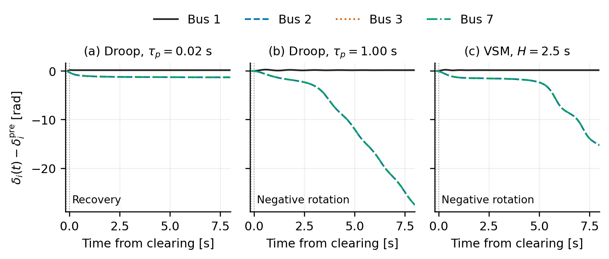
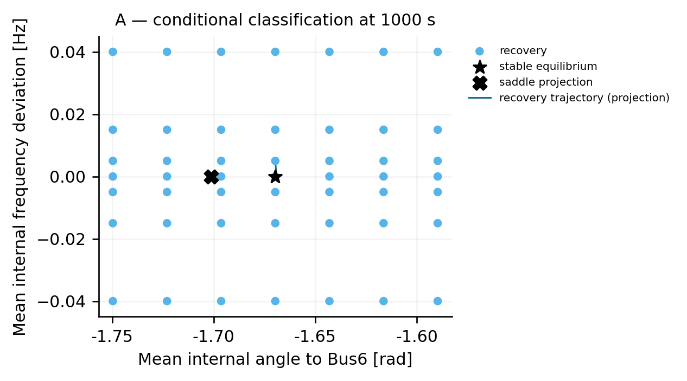
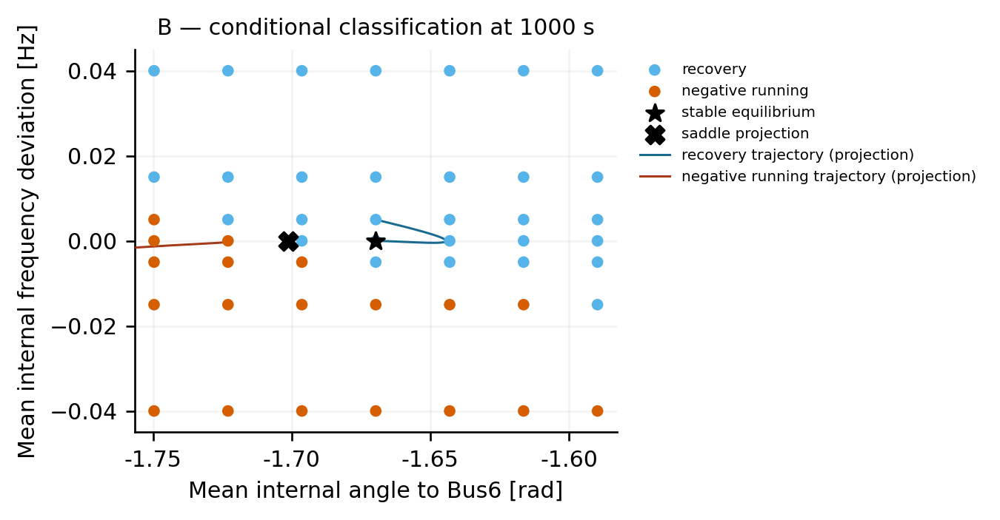
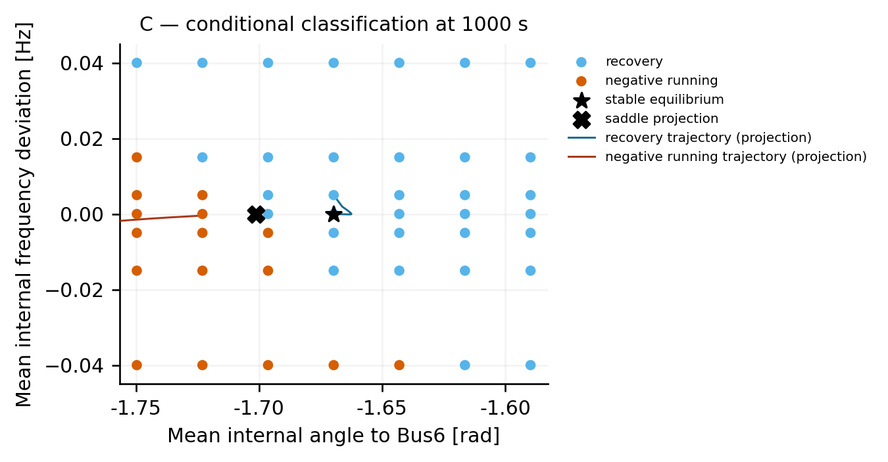
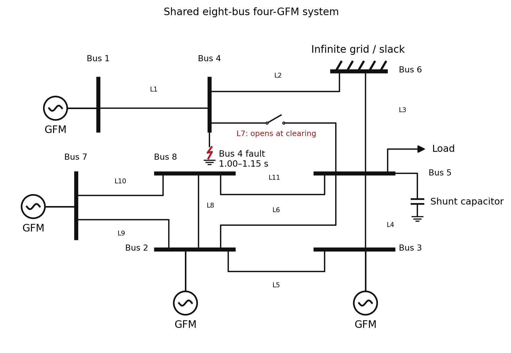

# GFM negative rotation: shared Droop and VSM reproduction

This repository reproduces recovery and negative internal-angle rotation in one **capacitor-compensated eight-bus, four-inverter network**. The network, operating point, LCL filters, inner PI controllers, current-command limiter and contingency are shared. Droop uses an explicit measured-active-power filter; VSM uses an explicit swing equation and washout damping. The model is balanced and averaged, without PWM or DC-source dynamics.

The results are observations over a finite interval, **not a proof of permanent rotation**. All paper and additional physical-fault cases below use the compensated network; the pre-fault Bus5 voltage is **0.996594324 pu**.

## Cases

All four inverters have the same outer-control settings within each case. `mp=0.05` means 5% on the model power base. The common Q-filter time constant is 0.02 s.

| Case | Control | P-filter τp [s] | H [s] | D₁ | D₂ | ωD [s⁻¹] | Result over 1000 s after clearing |
|---|---|---:|---:|---:|---:|---:|---|
| **A** | Droop | **0.02** | — | — | — | — | All four machines recover |
| **B** | Droop | **1.00** | — | — | — | — | Bus2/3/7 rotate negatively; Bus1 recovers |
| **C** | VSM | — | **2.5** | **0** | **100** | **50** | Bus2/3/7 rotate negatively; Bus1 recovers |
| C_D1_10 | VSM, additional comparison | — | 2.5 | **10** | 100 | 50 | All four machines recover |

A and B differ **only in τp**. C_D1_10 differs from C **only in D₁**. D₁=20 is not an adopted case. C is the previously verified **5%** case, rather than the earlier 10% case. No rotation-condition search was repeated for C; A/B succeeded with the two transferred τp candidates.

Inputs: [cases.csv](inputs/cases.csv), [common network and machine parameters](inputs/common.toml). [Full parameter definitions](docs/PARAMETERS.md), [migration and verification](docs/VALIDATION.md), [source attribution](NOTICE.md).

## Paper figure candidates

### Individual-machine time responses



The three panels show A, B and C under the common contingency. Bus1 is black, Bus2 blue/dashed, Bus3 orange/dotted and Bus7 green/dash-dot. Every machine is plotted individually; the remote-machine traces nearly overlap at this scale. No machine-average trace replaces them.

Time zero is **fault clearing**, at absolute time 1.15 s. The ordinate is the **unwrapped internal angle relative to its own pre-fault value**, in radians, in the fixed Bus6 frame. The same time and angle axes are used in all panels. Dotted vertical lines mark fault application (−0.15 s) and clearing (0 s). The displayed interval is −0.2 to 8 s; classification uses the full 1000 s.

[Input](inputs/cases.csv) · [A data](results/A/observations.csv.gz) · [B data](results/B/observations.csv.gz) · [C data](results/C/observations.csv.gz) · [PDF](figures/paper/time_response_ABC.pdf) · [Plot code](scripts/plot.py)

```bash
python scripts/plot.py --only time
```

The [1000 s comparison](figures/details/time_response_ABC_long.png), [individual voltage/current/P/Q responses](docs/DETAILS.md) and [D₁ comparison](figures/details/C_D1_comparison.pdf) are Git-only details.

### Conditional initial-state classification: A



A uses Droop with τp=0.02 s. **All 49 tested initial conditions recover** within the adopted 1000 s test. A recovery trajectory is shown. No negative-running trajectory was found on this grid, so none is drawn for A. This does not establish global recovery outside the tested section.

[Input](inputs/cases.csv) · [Classified points](results/basins/A/classification.csv) · [Full initial/final states and representative trajectories](results/basins/A/points/) · [Equilibria](results/basins/A/roots.csv) · [Section definition](results/basins/A/section.toml) · [PDF](figures/paper/basin_A.pdf) · [Plot code](scripts/plot.py)

### Conditional initial-state classification: B



B uses Droop with τp=1.00 s. The tested section contains **30 recovery and 19 negative-running points**. Recovery and negative-running representative trajectories are plotted. Relative to A, only τp changes.

[Input](inputs/cases.csv) · [Classified points](results/basins/B/classification.csv) · [Full initial/final states and representative trajectories](results/basins/B/points/) · [Equilibria](results/basins/B/roots.csv) · [Section definition](results/basins/B/section.toml) · [PDF](figures/paper/basin_B.pdf) · [Plot code](scripts/plot.py)

### Conditional initial-state classification: C



C uses VSM with H=2.5 s, mp=5%, D₁=0, D₂=100 and ωD=50 s⁻¹. The tested section contains **33 recovery and 16 negative-running points**. Recovery and negative-running representative trajectories are plotted. The network and inner controls match A/B.

[Input](inputs/cases.csv) · [Classified points](results/basins/C/classification.csv) · [Full initial/final states and representative trajectories](results/basins/C/points/) · [Equilibria](results/basins/C/roots.csv) · [Section definition](results/basins/C/section.toml) · [PDF](figures/paper/basin_C.pdf) · [Plot code](scripts/plot.py)

For all three classification figures:

- The horizontal coordinate is the **arithmetic mean of the unwrapped internal angles of Bus2/3/7**, relative to fixed slack Bus6, in radians. Zero is the slack angle; the stable-equilibrium angle is **not subtracted**.
- The vertical coordinate is the arithmetic mean of their **internal frequency deviations from 60 Hz**, in Hz. Zero is nominal frequency. Blue points recover; orange points meet the finite-time negative-running criterion. Gray denotes unresolved points if any occur. Colors classify the sampled initial conditions, not every location between them; no exact boundary is inferred or interpolated.
- The section starts from the case's post-fault stable equilibrium. Bus2/3/7 internal angles receive one common shift, and their complex Vc/If/Ig states rotate by that shift. Their initial internal frequency deviations are set equally to the requested value. Bus1, Q-filter states and dq PI-integrator states remain at their post-fault stable values. **All four VSM washout states start at z=0**, including at nonzero imposed frequency. The other algebraic bus voltages are solved exactly, rather than held fixed.
- A star marks the stable equilibrium on the section. The cross marks the **projection of the independently solved full saddle**, which generally lies off the section because its other states differ. It need not be a boundary point of this section. All three cases have a verified saddle with one unstable eigenvalue.
- The curves are projections of trajectories **launched from the defined section**. They subsequently leave that section. The physical-fault trajectory is not overlaid on these maps. These are finite-time, conditional classification maps, not the complete high-dimensional attraction basin.
- The same 7×7 coordinates are used: mean angle −1.669678513 ± 0.08 rad, and mean frequency deviations −0.04, −0.015, −0.005, 0, 0.005, 0.015, 0.04 Hz. Initial requested/actual coordinates, full states, classification settings and solver outcomes are saved for every point.

Recompute all three maps and redraw their PDFs/PNGs:

```bash
JULIA_NUM_THREADS=4 OPENBLAS_NUM_THREADS=1 julia --project=. scripts/basins.jl
python scripts/plot.py --only basins
```

### Shared single-line system diagram



GFM inverters connect at Bus1/2/3/7; Bus6 is fixed at 1∠0 pu and 60 Hz. Bus5 has a constant-impedance load and a parallel capacitor. The Bus4 symbol marks the **temporary 1.00–1.15 s consuming shunt fault**; L7 (Bus4–5) is shown open to identify the clearing operation. This is a contingency overview, not a simultaneous dynamic snapshot with the fault still applied. Line IDs refer to [the parameter table](docs/PARAMETERS.md).

[Input](inputs/common.toml) · [Diagram geometry and rendering](scripts/network_figure.py) · [Export and balance code](scripts/power_flow.py) · [Underlying common post-equilibrium data](results/power_flow/common_post_equilibrium/) · [PDF](figures/paper/system.pdf)

```bash
python scripts/power_flow.py
```

Matched-time dynamic power-flow figures at **0, 1 and 5 s after clearing** for each main case, plus shared pre/post-equilibrium flows, are in [the details index](docs/DETAILS.md). Dynamic snapshots and equilibrium flows are explicitly distinguished.

## Model and parameters

The common bus-voltage constraints are linear for the retained constant-impedance load and static lines. `src/model.jl` solves them exactly for the seven non-slack bus voltages. It retains all **52 differential states** of the original Droop DAE; VSM has **56 differential states**, including four washout states. The 14 eliminated algebraic variables are reconstructed at every observation. No dynamic state or inner-control time scale is removed.

Each inverter measures power at the **filter capacitor voltage Vc and grid-side filter current Ig**, rather than at the bus-terminal voltage U:

```math
S_{\mathrm{cap}}=V_C I_g^*,\qquad P=\Re(S_{\mathrm{cap}}),\qquad Q=\Im(S_{\mathrm{cap}}).
```

Positive P/Q denote inverter injection. Terminal power is separately stored as `U Ig*`.

Droop has an actual active-power filter state Pf:

```math
\tau_p\dot P_f=P-P_f,\qquad
\nu=m_p(P^*-P_f),\qquad
\dot\delta=\omega_0\nu.
```

VSM directly integrates normalized internal frequency deviation ν; it has **no active-power-filter state**:

```math
2H\dot\nu=P^*-P-\left(\frac{1}{m_p}+D_1\right)\nu-D_2(\nu-z),\qquad
\dot z=\omega_D(\nu-z),\qquad
\dot\delta=\omega_0\nu.
```

Here ν=(ω−ω₀)/ω₀, ω₀=2π60 rad/s, and D=1/mp=20 pu power/pu frequency. D and mp describe the same droop mechanism. D₁ acts on deviation from **fixed nominal frequency**, not on a PLL frequency difference. D₂ is washout damping with transfer function D₂s/(s+ωD), whose output vanishes for constant ν. Increasing D₁ to 10 changes the effective steady droop from 5% to **1/(20+10)=3.333…%** as well as the transient response.

The shared reactive-power and voltage-reference equations are:

```math
\tau_q\dot Q_f=Q-Q_f,\qquad V^*=V_{\mathrm{set}}-K_q(Q_f-Q^*).
```

| Shared setting | Value |
|---|---|
| P* at Bus1/2/3/7 [pu] | 0.5 / 0.4 / 0.4 / 0.4 |
| Q* at Bus1/2/3/7 [pu] | 0.16370094127236381 / 0.197690040391902 / 0.11248584940369824 / 0.05232080478579085 |
| Vset; Kq; τq | 1 pu; 0.05; 0.02 s |
| Inverter-side Rf, Lf; capacitor C [pu] | 0.0139, 0.0196; 0.1086 |
| Grid-side Rg, Lg [pu] | 0.01, 0.0209 |
| Voltage PI KP, KI; feedforward; cross coupling | 1.4476, 0.0273; 1; 1 |
| Current PI KP, KI; feedforward; cross coupling | 0.9817, 0.0018; 1; 1 |
| Virtual R, X | 0, 0 |
| Current-command limit; norm regularizer | 1.2 pu; 10⁻⁶ pu² |
| Bus5 load G; capacitive B [pu] | 2.268230115233306; 1 |
| Fault | Bus4 consuming conductance 20 pu, absolute 1.00–1.15 s |
| Clearing | Remove fault shunt and open L7 (Bus4–5) at 1.15 s |
| Post-fault horizon | 1000 s, through absolute time 1001.15 s |

The shunt capacitor remains connected before, during and after the fault. Load consumption is G|U5|² and capacitor reactive supply is B|U5|². Lf/Lg are frequency-normalized inductances and C is frequency-normalized capacitance; the explicit circuit equations contain L/ω₀ and C/ω₀. The Bus5 capacitor B is separate from each inverter's LCL capacitor C.

The limiter scales the voltage-controller **current command**; it does not clamp actual If/Ig instantaneously. All PI integrators and filter states start from the pre-fault equilibrium. Parameters use one common model power base and consistent voltage/current bases. A physical MVA rating is not inferred from a P* value.

[All line R/X values, controller equations, state ordering and units](docs/PARAMETERS.md) · [Complete canonical input](inputs/common.toml) · [Legacy 219-parameter alignment](provenance/parameter_alignment.csv).

### Droop–VSM equivalence without additional damping

With D₁=D₂=0, the transformation ν=mp(P*−Pf) gives:

```math
2H=\frac{\tau_p}{m_p},\qquad H=\frac{\tau_p}{2m_p}.
```

Thus the matched undamped Droop/VSM formulations are coordinate-equivalent, not two independent physical validations. The equation-level equivalence check disables both additional damping terms. **Main case C retains D₂=100**, and is not the undamped equivalent of A or B. At mp=5%, the undamped equivalent of H=2.5 s would have τp=0.25 s.

## Reproduction

Tested: **Julia 1.12.5**, OrdinaryDiffEq **6.108.0**; Python **3.13.9**, NumPy **2.3.4**, pandas **2.3.3**, Matplotlib **3.10.6**. `Project.toml`/`Manifest.toml` pin the Julia dependency environment without the old plotting and exploration dependencies. Python requires 3.11 or later for `tomllib`. The `gzip` command is required when rerunning integrations.

```bash
git clone https://github.com/hashima0205/GFM-negative-rotation.git
cd GFM-negative-rotation
julia +1.12.5 --project=. -e 'using Pkg; Pkg.instantiate()'
python3 -m venv .venv
. .venv/bin/activate
pip install -r requirements.txt
export MPLCONFIGDIR=/tmp/gfm-negative-rotation-mpl
export OPENBLAS_NUM_THREADS=1
```

Use `julia` below with Julia 1.12.5 selected, or replace it with `julia +1.12.5`.

```bash
# Main A/B/C and additional C_D1_10, from their own pre-fault equilibria.
JULIA_NUM_THREADS=1 julia --project=. scripts/run.jl cases.csv

# Equation reconstruction and undamped Droop/VSM equivalence.
julia --project=. scripts/check_equations.jl
julia --project=. scripts/check_conditions.jl
julia --project=. scripts/check_basins.jl

# Stricter integration of all three main cases.
JULIA_NUM_THREADS=1 julia --project=. scripts/run.jl cases.csv A,B,C --strict

# Replay original transferred Droop conditions, distinct from the common-system cases.
JULIA_NUM_THREADS=1 julia --project=. scripts/run.jl original_cases.csv original_A,original_B

# Compare source waveforms, migration and stricter integrations.
python scripts/validate.py
python scripts/compact_validation.py

# Independent conditional-section integrations; saved points are resumed by signature.
JULIA_NUM_THREADS=4 julia --project=. scripts/basins.jl

# Rebuild PDF/PNG figures from saved data; no integration is needed for these commands.
python scripts/plot.py
python scripts/power_flow.py
```

One case can be selected, e.g. `julia --project=. scripts/run.jl cases.csv C`. Running the case command regenerates its output files. Basin resume signatures reject changed model/input code; use a new results directory when changing those conditions.

Standard integration is adaptive **Rodas5P**, rtol=10⁻⁹, atol=10⁻¹¹, maximum internal step 0.005 s. The stricter profile uses 10⁻¹⁰, 10⁻¹² and 0.0025 s. These internal settings differ from saved output intervals: 0.01 s before the fault, 0.0005 s during it, 0.02 s after clearing, and 0.2 s in section trajectories.

Each main/additional result directory contains native full-state time series, individual-machine observations, input settings, pre/post roots, eigenvalue summaries, machine classifications and event/constraint checks. Native state and observation files use gzip-compressed CSV, not a ZIP bundle. Stricter/original replay tables retain the audited channels; their redundant full-state tables are not committed. `compact_validation.py` performs channel selection without temporal resampling or smoothing.

## Classification and verification scope

Classification is per machine, using the internal angle and frequency. The tail is the last min(50 s, horizon/3). Recovery requires tail maximum |Δf|<10⁻⁴ Hz, final angle error to the stable equilibrium modulo 2π<0.002 rad, and unwrapped tail angle range<0.005 rad. Recovery after a complete phase slip is separately identified.

Negative running requires more than two net negative turns and negative progress exceeding 0.2 turns in **each** of three windows spanning the final 60% of the observation interval, with negative mean progress below −10⁻⁴ turns/s. Otherwise the point is unresolved. The aggregate label does not replace [per-machine metrics](results/C/machines.csv). Turn counts use the post-fault/section initial state as their origin; the paper time-response ordinate instead uses the shared pre-fault angle origin.

The committed validation records include:

- All **1932 handoff files** passed their supplied SHA-256 checks.
- Original Droop replay, C and C_D1_10 source reproduction, and all three stricter main integrations passed **230 waveform comparisons**. The largest observed absolute difference was **3.83×10⁻⁸ in the corresponding observable's own unit**; the per-channel units and errors are in [waveform_comparisons.csv](results/validation/waveform_comparisons.csv).
- Main-case network-constraint residuals are below 10⁻¹³. Differential states and VSM washout states are continuous at both switches, with recorded jumps zero.
- Stable equilibria and one-unstable-direction saddles were solved and checked for A/B/C. Each section initial coordinate was checked against the requested coordinate after algebraic reconstruction.
- Matched-time power-flow snapshots pass bus-current, bus-power and whole-network active/reactive-power balance checks. The network boundary is at the inverter terminals, not at the internal voltage sources.

[Detailed verification, original/common-condition changes, source commits and limitations](docs/VALIDATION.md). Original-condition Droop replay is retained only as source-migration evidence, not as a paper case. The original VSM/Droop repositories, handoff and manuscript are not required at runtime.

## Repository layout

| Path | Content |
|---|---|
| `src/model.jl` | Shared network, LCL, PI, limiter, explicit Droop/VSM equations and equilibrium functions |
| `inputs/` | Canonical common and original-Droop inputs, cases and equilibrium seeds |
| `scripts/run.jl`, `scripts/basins.jl` | Physical-fault and conditional-section integration |
| `scripts/check_equations.jl`, `scripts/validate.py` | Equation/source reproduction and numerical comparisons |
| `scripts/plot.py`, `scripts/power_flow.py`, `scripts/network_figure.py` | Saved-data plotting and audited single-line figures |
| `results/A,B,C,C_D1_10/` | Main and additional detailed results |
| `results/basins/`, `results/power_flow/`, `results/validation/` | Section states/classifications, snapshots and validation evidence |
| `figures/paper/` | Publication candidates, each as PDF and PNG |
| `figures/details/`, `docs/DETAILS.md` | Git-only supplementary figures and their index |
| `provenance/` | Source identities, parameter alignment and compact source reference data |

For a paper, cite this repository with the exact release or commit used; see [CITATION.cff](CITATION.cff).
