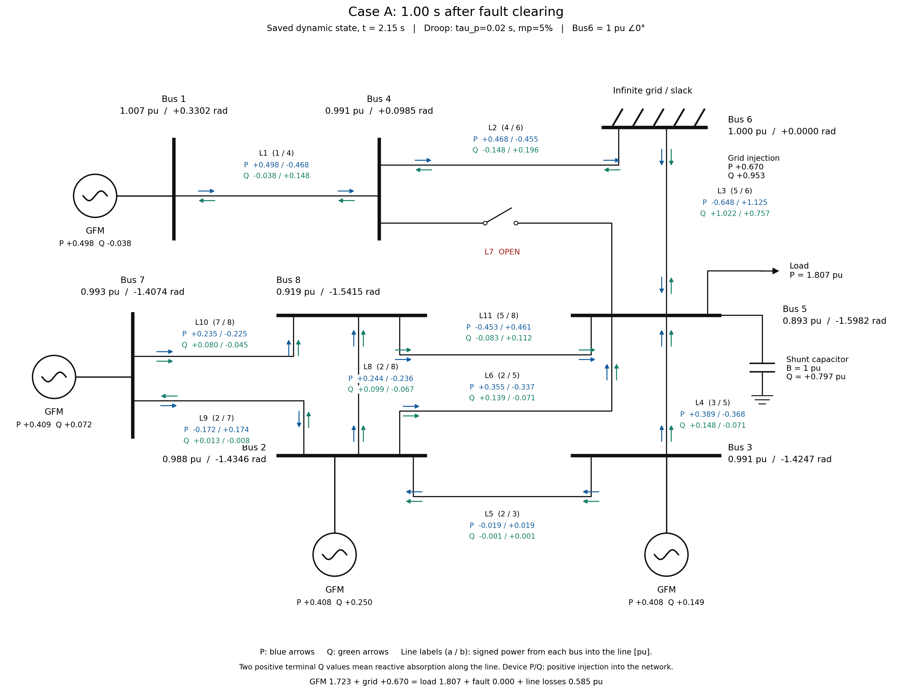
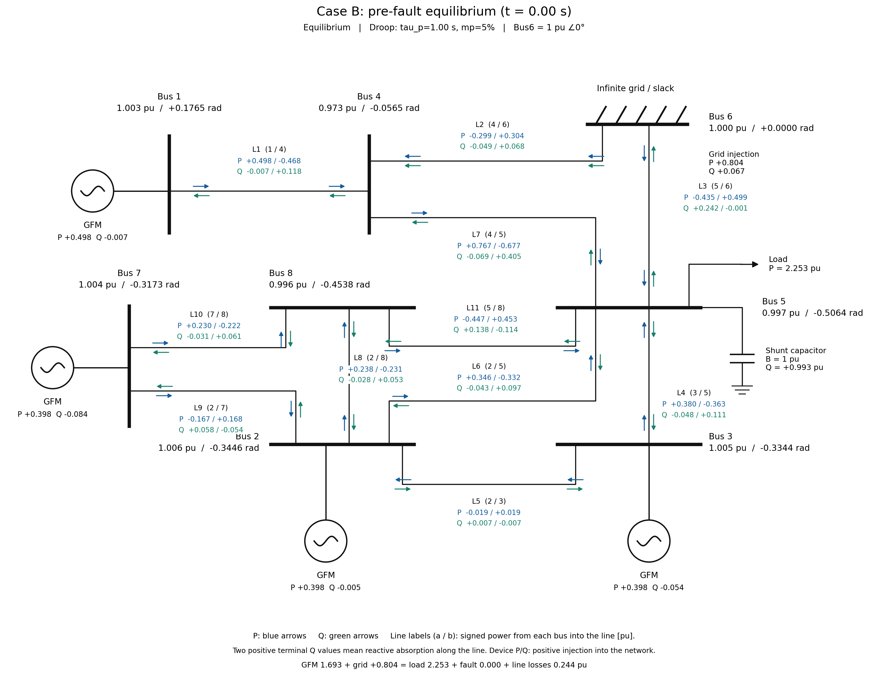
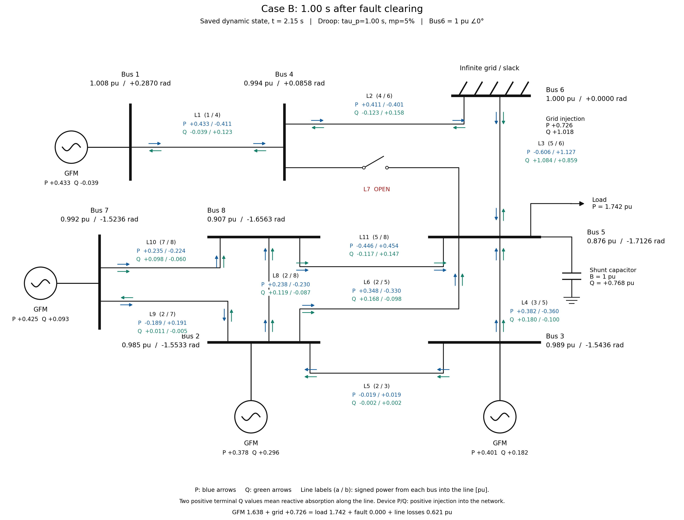
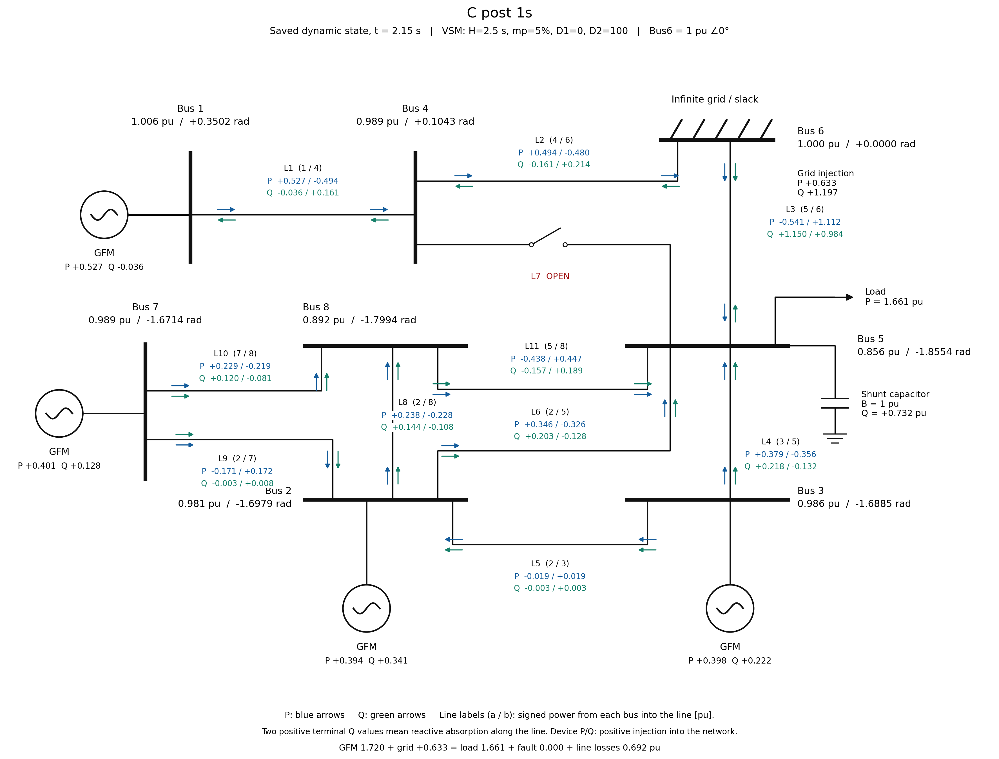

# GFM negative rotation: Droop and VSM

This repository provides a reproducible comparison of recovery and negative internal-angle rotation in a **capacitor-compensated eight-bus network with four grid-forming inverters**. Droop and VSM share the network, load, commands, LCL filters, inner PI controllers, current-command limiter and fault scenario. The balanced averaged model retains the circuit and controller dynamics; it does not model PWM or a DC source.

Read in order: [system](#system-and-contingency) → [controls and cases](#control-models-and-cases) → [results](#main-results) → [reproduction](#execution) → [verification](#verification-and-interpretation) → [files and sources](#files-sources-and-citation).

## System and contingency


GFM units connect to Bus1/2/3/7. Bus6 is a fixed slack at 1∠0 pu and 60 Hz. Bus5 has a constant-impedance load and a parallel capacitor (G=2.268230115233306 pu, capacitive B=1 pu). The capacitor remains connected throughout; the common pre-fault Bus5 voltage is 0.996594324 pu.

A consuming shunt fault of 20 pu is applied at **Bus4 at absolute t=1.00 s**. At **t=1.15 s** the shunt is removed and L7 (Bus4–5) opens. The diagram identifies both the fault location and clearing operation; it is a scenario overview. A/B/C start at the same pre-fault equilibrium. In phase-plane plots its mean remote internal angle is −0.323414657 rad relative to Bus6, with zero frequency deviation.

[System PDF](figures/paper/system.pdf) · [Physical inputs](inputs/common.toml) · [Line and device definitions](docs/PARAMETERS.md) · [Drawing code](src/network_plot.py).

## Control models and cases

Measured power is at the **filter capacitor voltage Vc and grid-side filter current Ig**:

```math
P+jQ=V_C I_g^*,\qquad \nu=(\omega-\omega_0)/\omega_0,\qquad \omega_0=2\pi60.
```

Positive P/Q mean inverter injection. Terminal powers `U Ig*` are recorded separately. Internal angles are unwrapped in the fixed Bus6 frame. The actual Droop power-filter state and VSM frequency/washout states use separate calculation paths:

```math
\text{Droop:}\quad \tau_p\dot P_f=P-P_f,\quad \nu=m_p(P^*-P_f),\quad \dot\delta=\omega_0\nu.
```

```math
\text{VSM:}\quad 2H\dot\nu=P^*-P-\left(\frac1{m_p}+D_1\right)\nu-D_2(\nu-z),\quad
\dot z=\omega_D(\nu-z),\quad \dot\delta=\omega_0\nu.
```

Both use τq Q̇f=Q−Qf and V*=Vset−Kq(Qf−Q*). Shared settings include mp=0.05 (5%), τq=0.02 s, Vset=1 pu, Kq=0.05 and P*=[0.5,0.4,0.4,0.4] pu at Bus1/2/3/7. The circular 1.2 pu limiter acts on the **current command**, not instantaneously on physical If/Ig. Units, Q commands, circuit/PI coefficients and the full state ordering are in [PARAMETERS](docs/PARAMETERS.md).

| Case | Control | τp [s] | H [s] | D₁ | D₂ | ωD [s⁻¹] | Fault response over 1000 s after clearing |
|---|---|---:|---:|---:|---:|---:|---|
| **A** | Droop | 0.02 | — | — | — | — | All machines recover |
| **B** | Droop | 1.00 | — | — | — | — | Bus2/3/7 rotate negatively; Bus1 recovers |
| **C** | VSM | — | 2.5 | 0 | 100 | 50 | Bus2/3/7 rotate negatively; Bus1 recovers |
| C_D1_10 | Additional VSM comparison | — | 2.5 | 10 | 100 | 50 | All machines recover |

A/B differ only in τp; C/C_D1_10 differ only in D₁. D=1/mp=20 and mp describe the same nominal-frequency droop mechanism. D₁ adds nominal-frequency damping; D₂ supplies washout damping D₂s/(s+ωD). D₁=10 also changes effective steady droop to 1/(20+10)=3.333…%.

With **D₁=D₂=0**, the transformation ν=mp(P*−Pf) makes Droop and VSM coordinate-equivalent when:

```math
2H=\frac{\tau_p}{m_p}.
```

This equivalence is not independent physical evidence. C retains D₂=100; its undamped equivalent would have τp=0.25 s.

Canonical settings: [case table](inputs/cases.csv), [physical parameters](inputs/common.toml), [numerics/classification](inputs/study.toml), [presentation](inputs/figures.toml), [main section](inputs/fault_basin.toml), [local section](inputs/local_basin.toml).

## Main results

### Time responses


Each panel is one case. The ordinate is δi(t)−δi(pre) [rad]; time zero is clearing at absolute 1.15 s. Common axes show −0.2 to 8 s. Dotted vertical lines mark fault application and clearing. Bus1 is black/solid, Bus2 blue/dashed, Bus3 orange/dotted, Bus7 green/dash-dot. Individual machines are retained even where traces overlap. Classification uses the full 1000 s, rather than the displayed interval.

Data are `results/<case>/observations.csv.gz`. [PDF](figures/paper/time_response_ABC.pdf) · [Figure/data index](docs/DETAILS.md). Redraw: `python scripts/plot.py --only time`.

### Conditional initial-state classifications

The following common definitions apply to **all three figures**:

- Horizontal: arithmetic mean of the unwrapped internal angles of **Bus2/3/7**, relative to fixed slack Bus6 [rad]. Vertical: their arithmetic mean internal frequency deviation from 60 Hz [Hz]. No equilibrium or pre-fault angle is subtracted.
- The background is a **1000 s classification on a specified initial-state section**. It is not the complete high-dimensional attraction basin.
- The real fault path and full-state saddle are **projections**. Their other states generally lie outside that initial section; background color alone cannot determine the real fault trajectory's destination.
- Blue/orange points recover/run negatively. A colored triangle summarizes equally classified **vertices**, not a verification of its entire interior. Hatched triangles have mixed or unresolved vertex outcomes.
- The blue triangle marks the pre-fault state, purple the fault-on path, white circle clearing, black the first 30 post-fault seconds, star the stable equilibrium, and cross the saddle projection. Arrows show time direction. A recovers; B/C continue to the left beyond this view.

The initial section changes only the remote internal angles and frequency coordinates; electrical, PI, Q-filter, Bus1 and washout states start at the post-fault root. Exact state prescriptions, algebraic consistency and the **different** local diagnostic section are explained in [BASIN_VIEWS](docs/BASIN_VIEWS.md). The local section is not a zoom of these maps.


| Case | Recovery / negative-running points | Data | PDF |
|---|---|---|---|
| A | 43 / 0 | [States, labels, paths](results/fault_basins/A/) | [PDF](figures/paper/basin_A.pdf) |
| B | 13 / 30 | [States, labels, paths](results/fault_basins/B/) | [PDF](figures/paper/basin_B.pdf) |
| C | 19 / 24 | [States, labels, paths](results/fault_basins/C/) | [PDF](figures/paper/basin_C.pdf) |

Redraw: `python scripts/plot.py --only basins`. [Wide and local diagnostic figures](docs/DETAILS.md#phase-plane-details).

### Power-flow comparison

These repository detail figures pair each case's pre-fault equilibrium (absolute t=0 s) with its **saved dynamic state 1 s after clearing** (absolute t=2.15 s). The pre-fault flows share one dataset and are checked against each case separately. Post-fault snapshots are not equilibrium flows. Click an image for its full-size PNG; PDFs/data are in [the figure index](docs/DETAILS.md#equilibrium-and-matched-time-dynamic-power-flow).

| Case | Pre-fault | Clearing +1 s |
|---|---|---|
| A | [](figures/details/power_flow/A_pre_equilibrium.png) | [](figures/details/power_flow/A_post_1s.png) |
| B | [](figures/details/power_flow/B_pre_equilibrium.png) | [](figures/details/power_flow/B_post_1s.png) |
| C | [](figures/details/power_flow/C_pre_equilibrium.png) | [](figures/details/power_flow/C_post_1s.png) |

Bus labels show |U| [pu] and principal phase to Bus6 [rad]. P arrows are blue; Q arrows green. Line-end `a / b` powers are positive **from each bus into the line**; their sum is line absorption. Device powers are positive injections. L7 is connected before the fault and open afterward. [Six-view index](results/power_flow/comparison.csv). Redraw: `python scripts/plot_flow_comparison.py`.

Individual voltage/current/P/Q responses, the D₁ comparison, long responses and additional flow times are in [DETAILS](docs/DETAILS.md).

## Execution

Tested with Julia **1.12.5**, OrdinaryDiffEq **6.108.0**, Python **3.13.9** and the pinned [Python requirements](requirements.txt). Python 3.11+ supplies `tomllib`. Julia uses [Project](Project.toml)/[Manifest](Manifest.toml); integrations also require the `gzip` command.

```bash
git clone https://github.com/hashima0205/GFM-negative-rotation.git
cd GFM-negative-rotation
python3 -m venv .venv
. .venv/bin/activate
pip install -r requirements.txt
```

Choose the task you need; the following are **independent workflows**, not a sequence requiring every calculation.

| Task | Minimal command after dependencies are ready | Output |
|---|---|---|
| Redraw saved time/section figures | `python scripts/plot.py` | `outputs/figures/` |
| Redraw saved system/flow figures | `python scripts/power_flow.py` | `outputs/figures/` |
| Recompute one case | `julia --project=. scripts/run.jl cases.csv C` | `outputs/runs/C/` |
| Recompute main conditional sections | `julia --project=. scripts/fault_basins.jl` | `outputs/fault_basins/` |
| Compare saved accuracy/source waveforms | `python scripts/validate.py` | `outputs/checks/` |
| Check equations and reference regression | `julia --project=. scripts/check_refactor.jl` | `outputs/checks/` |

**Replotting uses saved data and requires no Julia time integration or Julia environment setup.** Before Julia calculations/checks, run `julia +1.12.5 --project=. -e 'using Pkg; Pkg.instantiate()'`, and select Julia 1.12.5 for the commands above. Use `OPENBLAS_NUM_THREADS=1`; section runs can use `JULIA_NUM_THREADS=8`.

`--output <directory>` selects a separate output location. Computations reject conflicting existing runs; section resumption requires matching recorded inputs/code/root. Plotting and checks do not modify committed `results/` or `figures/`. Changed inputs or computational code cause a stale-result error instead of silently reusing reference data. [Purpose-specific commands, strict runs and result identities](docs/RUNNING.md).

## Verification and interpretation

The stored main cases retain their validated numerical results. The code organization was checked with exact same-state RHS/observations/voltage/state conversions, representative physical-event integrations and full saved-waveform classifications. Numerical settings, state order, power measurement positions, signs and units are retained. [Refactor verification and dependency map](docs/REPRODUCIBILITY.md).

The accuracy/source checks contain 230 passing per-channel comparisons (largest error 3.83×10⁻⁸ in that observable's own unit). Main algebraic residuals are below 10⁻¹³; differential states and VSM z are continuous at switches. Equilibria/saddles and terminal-network P/Q balances are checked. [Detailed numerical/source validation](docs/VALIDATION.md).

Recovery and rotation are **finite-time, per-machine classifications**. Recovery checks tail frequency, phase error modulo 2π and phase range; negative running checks net turns and consistent negative progress across three late windows. Exact thresholds are in [study.toml](inputs/study.toml). Neither 1000 s rotation nor sampled section colors prove permanent rotation or an exact basin boundary.

## Files, sources and citation

| Directory | Responsibility |
|---|---|
| `src/` | Model/network/control/equilibrium, integration, observation/classification, section initialization and shared saved-data processing |
| `inputs/` | Canonical physical values, case settings, numerical/classification settings and section definitions |
| `scripts/` | Calculation, verification and plotting entry points; importing them starts no computation |
| `results/` | Preserved case states/waveforms, roots, labels and checks; dataset records identify their settings/code |
| `figures/paper/`, `figures/details/` | Paper candidates and repository details; [figure source catalog](figures/catalog.toml) |
| `docs/` | [Parameters](docs/PARAMETERS.md), [figure guide](docs/DETAILS.md), [execution](docs/RUNNING.md), [section definitions](docs/BASIN_VIEWS.md), [verification](docs/VALIDATION.md) |
| `provenance/` | Original implementation/data attribution, reference fixtures and [result identities](provenance/reproduction.toml) |

The VSM and Droop source identities, execution-input hashes and migration checks are retained in [NOTICE](NOTICE.md), [VALIDATION](docs/VALIDATION.md) and [provenance](provenance/). They are not runtime dependencies. Cite the exact repository commit used; [CITATION.cff](CITATION.cff) provides citation metadata.
