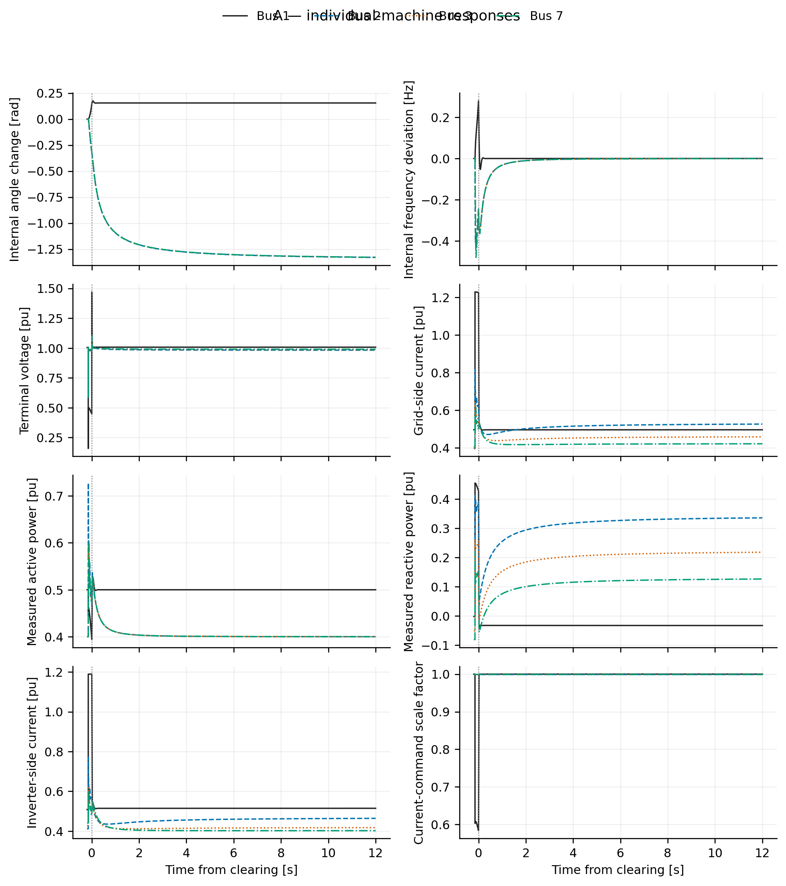
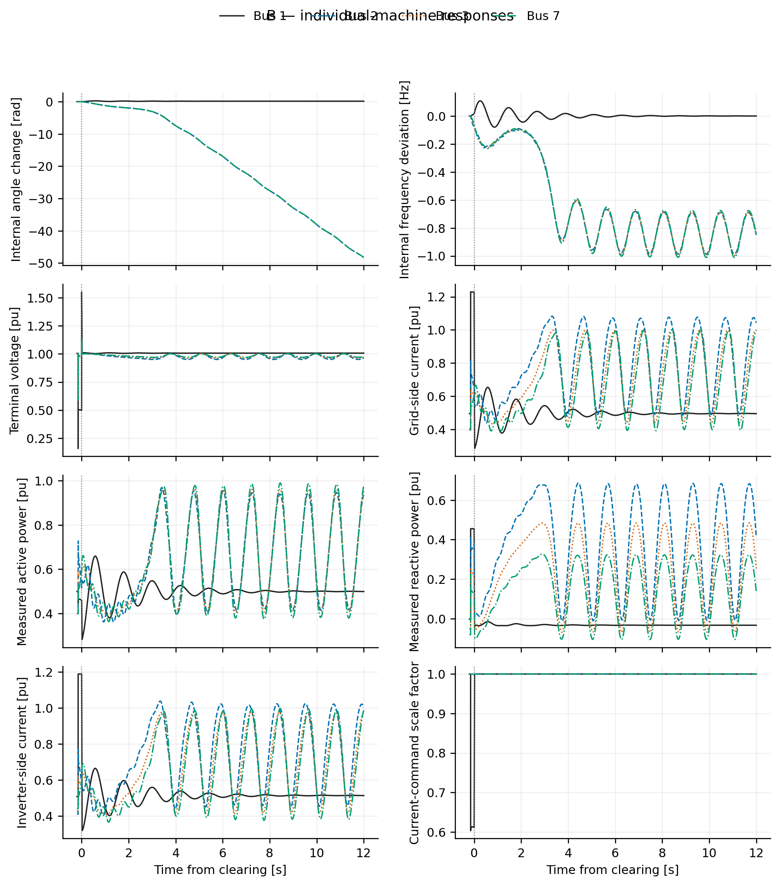
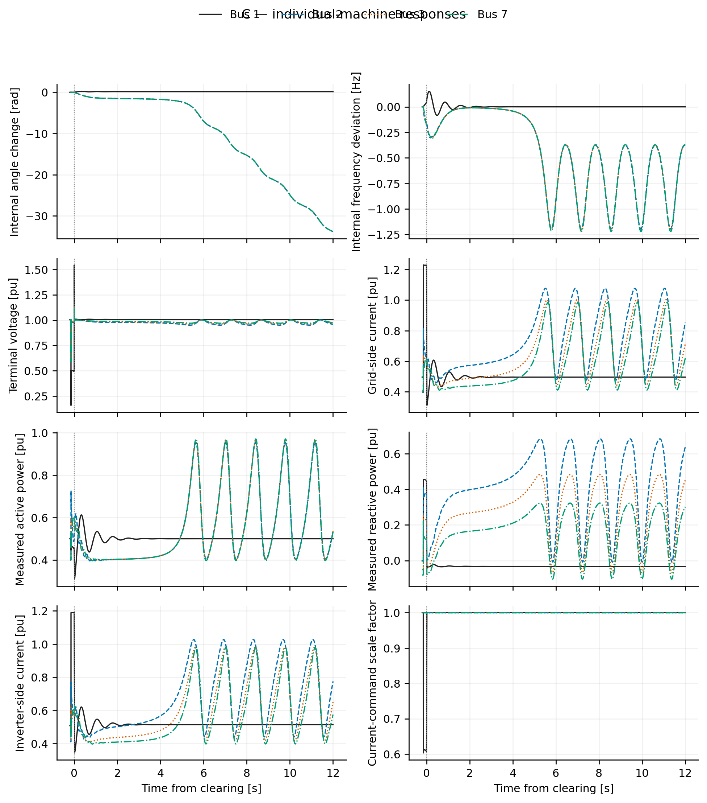
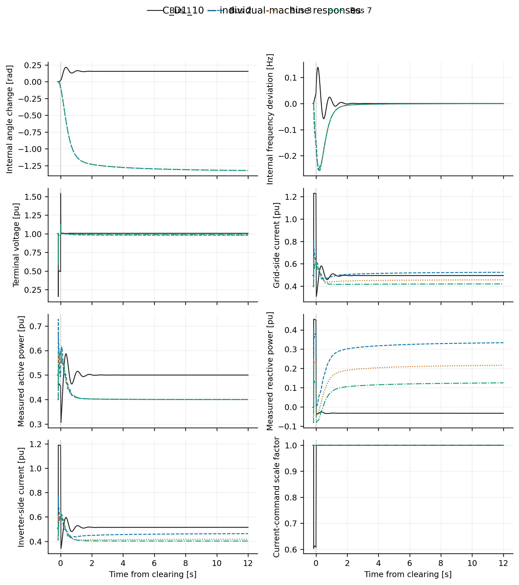
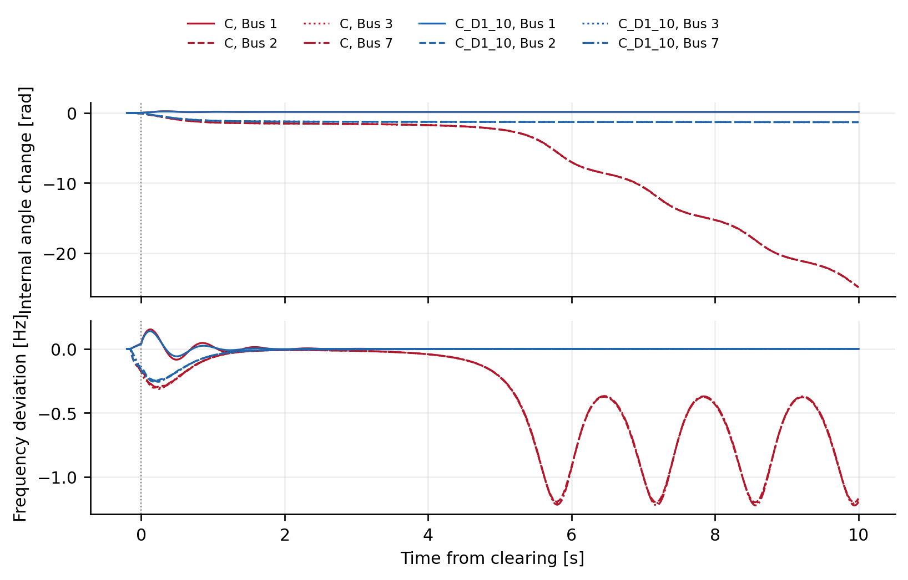

# Detailed figures and data

These figures are retained for repository inspection; the paper candidates are in [figures/paper](../figures/paper/). Every listed figure has a PDF and PNG. All time responses use fixed Bus6 internal angles, seconds from clearing, the same machine colors and unprocessed individual-machine samples.

## Main and additional responses

### A

[PDF](../figures/details/A_responses.pdf) · [Observations](../results/A/observations.csv.gz) · [Native full states](../results/A/states.csv.gz) · [Input](../inputs/cases.csv) · [Plot code](../scripts/plot.py)

### B

[PDF](../figures/details/B_responses.pdf) · [Observations](../results/B/observations.csv.gz) · [Native full states](../results/B/states.csv.gz) · [Input](../inputs/cases.csv) · [Plot code](../scripts/plot.py)

### C

[PDF](../figures/details/C_responses.pdf) · [Observations](../results/C/observations.csv.gz) · [Native full states](../results/C/states.csv.gz) · [Input](../inputs/cases.csv) · [Plot code](../scripts/plot.py)

### C_D1_10

[PDF](../figures/details/C_D1_10_responses.pdf) · [Observations](../results/C_D1_10/observations.csv.gz) · [Native full states](../results/C_D1_10/states.csv.gz) · [Input](../inputs/cases.csv) · [Plot code](../scripts/plot.py)

[D₁ comparison PDF](../figures/details/C_D1_comparison.pdf): C versus C_D1_10, with only D₁ changed from 0 to 10. Red/blue distinguish the cases; line styles distinguish machines. This changes effective steady droop to 3.333…% as well as damping.

[Long 1000 s comparison PNG](../figures/details/time_response_ABC_long.png) · [PDF](../figures/details/time_response_ABC_long.pdf).

Recreate the above with `python scripts/plot.py --only time`.

## Phase-plane details

The main figures start at the actual pre-fault state and include the fault-on and post-fault paths. Wide views use a common −150 to 0 rad range to show the full first 30 s: A recovers, B/C continue negatively. Frequency limits, markers, stage colors and background match the main views.

| Case | First-30-s wide view | Separate local section diagnostic |
|---|---|---|
| A | [PNG](../figures/details/basin_A_wide.png) · [PDF](../figures/details/basin_A_wide.pdf) | [PNG](../figures/details/basin_local_A.png) · [PDF](../figures/details/basin_local_A.pdf) |
| B | [PNG](../figures/details/basin_B_wide.png) · [PDF](../figures/details/basin_B_wide.pdf) | [PNG](../figures/details/basin_local_B.png) · [PDF](../figures/details/basin_local_B.pdf) |
| C | [PNG](../figures/details/basin_C_wide.png) · [PDF](../figures/details/basin_C_wide.pdf) | [PNG](../figures/details/basin_local_C.png) · [PDF](../figures/details/basin_local_C.pdf) |

The 49-point local diagnostic uses rotated initial Vc/If/Ig, small coordinate ranges and section-launched curves. It is **not a magnification of the revised background**; its results are unchanged. [Definitions and differences](BASIN_VIEWS.md). Replot main/wide views with `python scripts/plot.py --only basins`, local diagnostics with `--only local-basins`. [Main input](../inputs/fault_basin.toml), [main data](../results/fault_basins/), [local data](../results/basins/).

## Equilibrium and matched-time dynamic power flow

The common pre/post equilibria are shared positions of the different controllers at ν=0; their local stability is checked separately for each controller. Dynamic diagrams show saved states, not equilibrium solutions. Every bus label includes terminal-voltage magnitude [pu] and principal phase [rad]. Every active branch lists signed P/Q from each end into the branch [pu]. Blue/green arrows denote P/Q.

| Case | Snapshot | PNG | PDF | Audited data |
|---|---|---|---|---|
| common | common_pre_equilibrium | [PNG](../figures/details/power_flow/common_pre_equilibrium.png) | [PDF](../figures/details/power_flow/common_pre_equilibrium.pdf) | [Data](../results/power_flow/common_pre_equilibrium/) |
| common | common_post_equilibrium | [PNG](../figures/details/power_flow/common_post_equilibrium.png) | [PDF](../figures/details/power_flow/common_post_equilibrium.pdf) | [Data](../results/power_flow/common_post_equilibrium/) |
| A | A_pre_equilibrium | [PNG](../figures/details/power_flow/A_pre_equilibrium.png) | [PDF](../figures/details/power_flow/A_pre_equilibrium.pdf) | [Shared data](../results/power_flow/common_pre_equilibrium/) |
| B | B_pre_equilibrium | [PNG](../figures/details/power_flow/B_pre_equilibrium.png) | [PDF](../figures/details/power_flow/B_pre_equilibrium.pdf) | [Shared data](../results/power_flow/common_pre_equilibrium/) |
| C | C_pre_equilibrium | [PNG](../figures/details/power_flow/C_pre_equilibrium.png) | [PDF](../figures/details/power_flow/C_pre_equilibrium.pdf) | [Shared data](../results/power_flow/common_pre_equilibrium/) |
| A | A_post_0s | [PNG](../figures/details/power_flow/A_post_0s.png) | [PDF](../figures/details/power_flow/A_post_0s.pdf) | [Data](../results/power_flow/A_post_0s/) |
| A | A_post_1s | [PNG](../figures/details/power_flow/A_post_1s.png) | [PDF](../figures/details/power_flow/A_post_1s.pdf) | [Data](../results/power_flow/A_post_1s/) |
| A | A_post_5s | [PNG](../figures/details/power_flow/A_post_5s.png) | [PDF](../figures/details/power_flow/A_post_5s.pdf) | [Data](../results/power_flow/A_post_5s/) |
| B | B_post_0s | [PNG](../figures/details/power_flow/B_post_0s.png) | [PDF](../figures/details/power_flow/B_post_0s.pdf) | [Data](../results/power_flow/B_post_0s/) |
| B | B_post_1s | [PNG](../figures/details/power_flow/B_post_1s.png) | [PDF](../figures/details/power_flow/B_post_1s.pdf) | [Data](../results/power_flow/B_post_1s/) |
| B | B_post_5s | [PNG](../figures/details/power_flow/B_post_5s.png) | [PDF](../figures/details/power_flow/B_post_5s.pdf) | [Data](../results/power_flow/B_post_5s/) |
| C | C_post_0s | [PNG](../figures/details/power_flow/C_post_0s.png) | [PDF](../figures/details/power_flow/C_post_0s.pdf) | [Data](../results/power_flow/C_post_0s/) |
| C | C_post_1s | [PNG](../figures/details/power_flow/C_post_1s.png) | [PDF](../figures/details/power_flow/C_post_1s.pdf) | [Data](../results/power_flow/C_post_1s/) |
| C | C_post_5s | [PNG](../figures/details/power_flow/C_post_5s.png) | [PDF](../figures/details/power_flow/C_post_5s.pdf) | [Data](../results/power_flow/C_post_5s/) |

The [README six-view comparison](../README.md#power-flow-comparison-three-cases-before-and-after-the-fault) pairs each case's pre-fault view with its clearing+1 s snapshot. Pre-fault views share the canonical dataset and are checked against the saved observations of A/B/C separately. [Six-view index](../results/power_flow/comparison.csv), [validation](../results/validation/power_flow_comparison.json). Redraw only these six with `python scripts/plot_flow_comparison.py`.

Recreate and audit all flows with `python scripts/power_flow.py`; [export code](../scripts/power_flow.py), [single-line renderer](../scripts/network_figure.py), [network inputs](../inputs/common.toml). The plots distinguish equilibrium and dynamic time in their headers. Each data folder contains bus/line powers and `audit.json`, including current KCL, nodal complex-power and whole-network P/Q balance errors.
