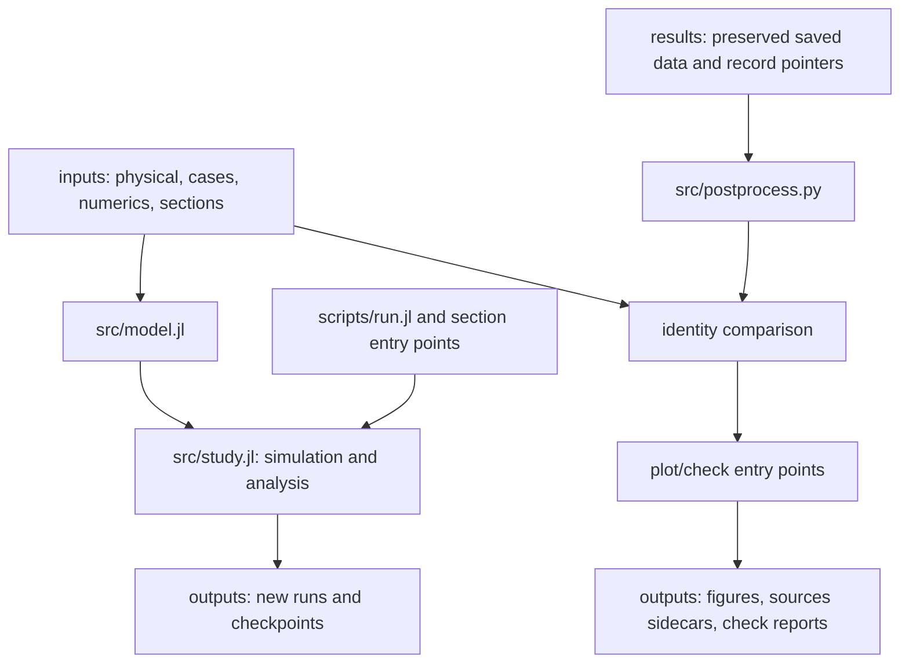

# Code responsibilities and reproducibility

Refactor base: **907d0e922bd360fd576653fcbc56a0481ad88b1c**. Work is on a dedicated review branch; no model/input search or manuscript edit is part of this change.

## Dependencies and responsibility boundaries

| File | Responsibility |
|---|---|
| `src/model.jl` | Model module, typed parameters, input loading and native/legacy state layout |
| `src/network.jl` | Pre/fault/post admittance matrices and exact algebraic-voltage elimination/reconstruction |
| `src/dynamics.jl` | LCL and inner PI equations, limiter, explicit Droop P filter and VSM swing/washout dynamics |
| `src/equilibria.jl` | State conversion, measurements, Newton equilibrium solve, Jacobian and spectrum |
| `src/study.jl` | Shared library entry, case/CSV I/O, run identities, output protection and library imports |
| `src/analysis.jl` | Internal frequency/angle coordinates, section state prescriptions and per-machine classification |
| `src/simulation.jl` | Adaptive integration, equilibrium initialization, physical-event schedule and case outputs |
| `src/sections.jl` | Section roots, point integration and point output records |
| `src/postprocess.py` | Read-only dataset identities/settings, common Python coordinates and isolated output paths |
| `src/network_plot.py`, `src/flows.py` | System drawing, saved-state network-flow analysis/export and flow views |
| `src/toml_writer.py` | Small identity-record serializer; no additional Python dependency |
| `scripts/` | User-facing calculation, plotting and checking commands |

Including Julia library files or importing Python entry modules starts no integration, plotting, export or verification. Entry guards invoke work only when scripts are executed. There is no dependency on including `scripts/run.jl` from another script. Model equations and their arithmetic order were moved without changing the native state ordering or algebraic elimination.

## Settings and identities

Physical inputs remain in `common.toml` / `original_droop.toml`, with case rows in the corresponding CSVs. `study.toml` collects the previously implicit topology/remote group, solver settings, classifier thresholds and seed selection; `figures.toml` independently holds presentation settings. `fault_basin.toml` and `local_basin.toml` specify distinct initial-state experiments. The structural native state layout is defined once by the model and documented in PARAMETERS; it is not a tunable numerical parameter.

The archived input text in `provenance/reproduction.toml` describes the preserved results. Each dataset pointer links to case rows and exact data hashes. The original source-generation release is recorded separately from the verified refactored-code binding. The catalog does **not** claim that all long simulations were rerun with the reorganized file paths.

Presentation settings have a separate input and figure fingerprint. Changing display colors or ranges permits a new drawing without invalidating the numerical dataset. Numerical-input, computational-code and saved-data mismatches still stop data reuse. Section identities additionally include their own section input and target root.

New Julia outputs record full case/configuration text, numerical settings, code/input hashes, profile/horizon and finalized output hashes. Section records also bind the exact target-root file and section definition. A conflicting physical output is rejected; section resumption requires identical identities. Baseline data/source directories are not output destinations.

Python reads controller type, mp, P commands, base frequency and event times from the result's settings, not from A/B/C name tests. Main-case labels select figures only. Drawing reads saved classifications/triangles/projections; it does not rewrite them or report success by editing validation baselines. Plot artifacts carry source/axis sidecars, while [figures/catalog.toml](../figures/catalog.toml) links preserved figures to the saved datasets.

## Verification design

- Original and refactored RHS, all machine measurements, network-voltage reconstruction and legacy/native conversion are compared at identical states under every topology. The same matrices and arithmetic produce zero differences.
- A/B/C physical-event schedules are independently rerun through 5 post-clearing seconds with the original and refactored code in isolated directories. Their saved native waveforms agree exactly. Switch-state continuity and VSM z handover are checked by the existing event records and the representative reruns.
- All 50001 saved post-fault samples of each adopted physical case are reclassified; every machine label and numerical classification metric is retained.
- The 230 existing strict/source comparisons, both section initial-state checks and network-flow checks are rerun into a temporary directory.
- Replotting is exercised into temporary outputs, with figure axes/data sources checked and baseline-file hashes checked before/after. Changed-input/code and conflicting-output probes use isolated copies.

The compact [refactor reference](../provenance/refactor_reference.toml) records original-code RHS/voltage fixtures; `scripts/check_refactor.jl` verifies these and full saved classifications. Final evidence and limitations are in [refactor validation](../provenance/refactor_validation.toml). No full parameter search or wholesale repetition of the 1000 s integrations is required for this structural change.

## Migration from the prior command behavior

`plot.py`, `plot_fault_basins.py`, the flow views and standalone network renderer now draw only. Their former writes to classification/projection/triangulation CSVs, power-flow tables and verification baselines were removed. `power_flow.py --export` is the explicit derived-data export path. Numerical reference files and their source attribution remain in place; data-consumer links were checked before changing code locations.

The shared state/coordinate/classification functions replace the two section implementations' duplicated setup. File layout and CLI output locations changed; numerical equations, physical inputs, criteria, baseline samples and adopted case outcomes did not.
